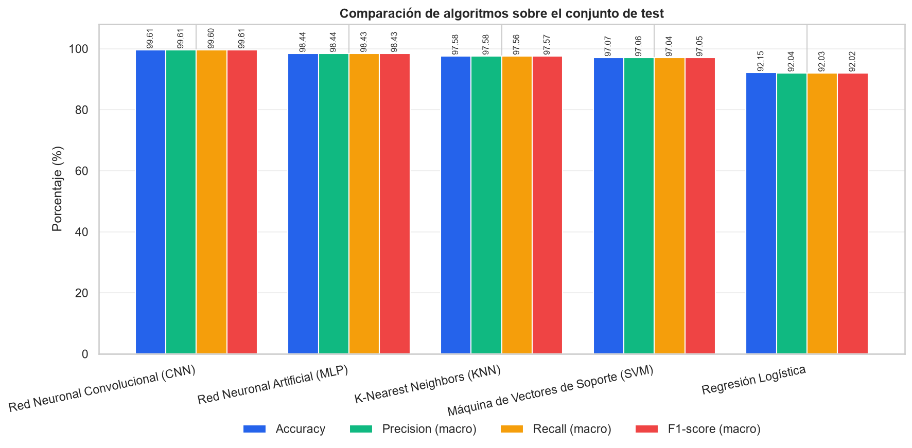

# Sistema Inteligente de Reconocimiento y Clasificación de Dígitos Manuscritos

Proyecto académico de **Machine Learning y Deep Learning** que reconoce dígitos
manuscritos del 0 al 9 usando el dataset **MNIST**, entrena y compara seis
algoritmos y ofrece una interfaz web para probar imágenes propias.



> Todas las métricas de este proyecto se obtienen ejecutando realmente el
> código sobre el conjunto de test oficial de MNIST. El archivo
> [`results/RESUMEN.md`](results/RESUMEN.md) se regenera con cada evaluación.

### Cumplimiento de las fases solicitadas

| Fase | Dónde se implementa |
|---|---|
| 1. Entorno y dependencias | `requirements.txt`, `main.py info`, este README |
| 2. Dataset MNIST | `src/dataset.py`, `python main.py prepare` |
| 3. Preprocesamiento | `src/preprocessing.py`, `src/segmentation.py` |
| 4. Algoritmos obligatorios | `src/models.py`, `src/training.py` |
| 5. CNN (conv, pool, flatten, dense, ReLU, softmax, Adam) | `src/models.py::build_cnn` |
| 6. Evaluación y validación cruzada | `src/evaluation.py`, `python main.py evaluate` |
| 7. Gráficos | `plots/` y `src/evaluation.py` |
| 8. Software Streamlit | `app.py` |
| 9. Estructura del proyecto | Sección 12 de este README |
| 10. Comentarios y documentación | Código en español + este README |
| 11. Pruebas y verificación | `tests/`, `python -m unittest discover -s tests -v` |

---

## 1. ¿Qué hace el proyecto?

1. Descarga MNIST automáticamente mediante TensorFlow/Keras.
2. Separa los datos en entrenamiento (54 000), validación (6 000) y prueba
   (10 000), sin mezclar información.
3. Preprocesa las imágenes: escala de grises, normalización, redimensionado a
   28×28, eliminación de ruido, umbralización y centrado por centro de masa.
4. Entrena estos algoritmos:

   | Clave | Algoritmo | Tipo |
   |---|---|---|
   | `logreg` | Regresión Logística multinomial | Supervisado |
   | `kmeans` | K-Means (10 clústeres) | **No supervisado** |
   | `knn` | K-Nearest Neighbors con PCA(50) | Supervisado |
   | `svm` | SVM con kernel RBF | Supervisado |
   | `mlp` | Red neuronal densa (TensorFlow/Keras) | Supervisado |
   | `cnn` | Red neuronal convolucional (TensorFlow/Keras) | Supervisado |

5. Evalúa con accuracy, precision, recall, F1-score y matriz de confusión.
6. Genera gráficos de entrenamiento, comparación, predicciones y agrupamiento.
7. Segmenta varios dígitos en una foto con OpenCV y los reconoce uno a uno.
8. Ofrece una interfaz Streamlit moderna con carga de imágenes, confianza por
   dígito, resultados de evaluación y explicación de cada algoritmo.

---

## 2. Herramientas utilizadas

- **Python 3.12**
- **TensorFlow 2.21 / Keras 3.15** — MLP y CNN
- **scikit-learn 1.9** — Regresión Logística, KNN, SVM, K-Means, métricas y
  validación cruzada
- **OpenCV 5.0** — preprocesamiento, umbralización, contornos y segmentación
- **NumPy / Pandas** — cálculo numérico y tablas
- **Matplotlib / Seaborn** — gráficos
- **Pillow** — carga de imágenes y corrección EXIF
- **Streamlit 1.67** — interfaz web
- **Joblib** — persistencia de modelos clásicos

> **Nota sobre Python:** TensorFlow 2.21 no publica wheels para Python 3.14.
> Por eso el proyecto usa Python 3.12. Si en el equipo solo hay 3.14, instala
> 3.12 antes de crear el entorno virtual.

---

## 3. Instalación

### 3.1 Comprobar Python

```bash
py -0p          # Windows: lista las versiones instaladas
python --version
```

Debe aparecer una versión **3.12.x**. Si no está instalada en Windows:

```powershell
winget install --id Python.Python.3.12 --scope user
```

### 3.2 Crear y activar el entorno virtual

Desde la carpeta `reconocimiento_digitos`:

```powershell
py -3.12 -m venv .venv
.\.venv\Scripts\Activate.ps1
python -m pip install --upgrade pip
python -m pip install -r requirements.txt
```

En Linux/macOS:

```bash
python3.12 -m venv .venv
source .venv/bin/activate
python -m pip install --upgrade pip
python -m pip install -r requirements.txt
```

En este equipo el entorno virtual se creó en la carpeta padre
(`SARA\.venv`) para compartir dependencias con el espacio de trabajo. En ese
caso, desde `reconocimiento_digitos` se activa con:

```powershell
..\.venv\Scripts\Activate.ps1
```

### 3.3 Comprobar las bibliotecas

```bash
python main.py info
```

Muestra la versión de Python, TensorFlow, OpenCV, scikit-learn, Streamlit, etc.

---

## 4. Dataset

MNIST se descarga automáticamente la primera vez:

```bash
python main.py prepare
```

- **70 000 imágenes** en escala de grises de **28×28 píxeles**.
- **60 000** oficiales de entrenamiento y **10 000** oficiales de prueba.
- Del bloque de entrenamiento se reservan **6 000** imágenes estratificadas
  para validación.
- Resultado: **54 000 train / 6 000 validación / 10 000 test**.
- El test **nunca** se usa para entrenar ni para elegir hiperparámetros.
- Las etiquetas se guardan en `data/labels/` y los arrays en
  `data/mnist_split.npz`.
- Los metadatos (conteos, formas, distribución de clases, fecha) se guardan en
  `data/dataset_info.json`.

La descarga se cachea en `~/.keras/datasets/mnist.npz`.

---

## 5. Entrenamiento

Entrenar todos los modelos:

```bash
python main.py train --model all
```

Entrenar solo algunos:

```bash
python main.py train --model cnn
python main.py train --model logreg knn svm
python main.py train --model kmeans mlp
```

Opciones:

- `--skip-existing` evita reentrenar modelos que ya existen.
- Cada modelo se guarda en `models/`.
- Los historiales de las redes se guardan en `results/history_*.csv`.
- Los metadatos (tiempo, muestras, validación, parámetros) se guardan en
  `results/training_*.json`.

Decisiones de viabilidad computacional:

- **SVM**: se entrena con un subconjunto estratificado de **12 000** imágenes
  para que el kernel RBF sea tratable en CPU; se evalúa sobre las 10 000 de
  test. Está indicado en la tabla y en los resultados.
- **KNN**: aplica **PCA(50)** antes de calcular distancias, porque con 784
  dimensiones el coste y la maldición de la dimensionalidad son prohibitivos.
- **K-Means**: se ajusta sobre una muestra aleatoria de 20 000 imágenes. El
  muestreo **no usa etiquetas**, coherente con su naturaleza no supervisada.
- **MLP y CNN**: usan el conjunto de validación con `EarlyStopping`,
  `ReduceLROnPlateau` y `ModelCheckpoint`.

---

## 6. Evaluación

```bash
python main.py evaluate
```

Genera:

- `results/metrics.csv` — accuracy, precision, recall y F1 (macro y ponderado)
  de cada clasificador sobre test.
- `results/classification_report_<modelo>.txt` — informe completo por clase.
- `results/classification_<modelo>.csv` — métricas por dígito.
- `results/cross_validation.csv` — validación cruzada de 3 folds de los modelos
  tradicionales sobre un subconjunto de 6 000 imágenes.
- `results/kmeans_metrics.json` — ARI, NMI, silueta, pureza y mapeo de clústeres.
- `plots/confusion_matrix_<modelo>.png` — matriz de confusión en valores
  absolutos y normalizados.
- `plots/training_<modelo>.png` — precisión y pérdida por época.
- `plots/model_comparison.png` — comparación de algoritmos.
- `plots/sample_predictions_<modelo>.png` — imágenes reales de test con la
  predicción y la confianza.
- `plots/kmeans_*.png` — centroides, proyección PCA, tamaños y confusión.
- `results/RESUMEN.md` — resumen en Markdown con las cifras de la última
  ejecución (se crea al final de `evaluate` desde la CLI `all` o con
  `python main.py all`).

Para omitir la validación cruzada:

```bash
python main.py evaluate --no-cv
```

### Cómo interpretar las métricas

- **Accuracy**: proporción de aciertos. Es útil si las clases están
  equilibradas, como en MNIST.
- **Precision (macro)**: de lo que el modelo predice como dígito *d*, qué
  fracción es realmente *d*. La media macro da el mismo peso a los 10 dígitos.
- **Recall (macro)**: de todas las imágenes reales del dígito *d*, cuántas
  detecta el modelo.
- **F1-score (macro)**: media armónica de precision y recall; resume el
  equilibrio entre ambas.
- **Matriz de confusión**: muestra qué dígitos se confunden entre sí. Las
  confusiones típicas son 4↔9, 3↔5 y 7↔1.
- **Validación cruzada**: estima la estabilidad del modelo en distintas
  particiones. No sustituye la evaluación final sobre test.
- **K-Means**: se evalúa con **ARI** (Rand ajustado), **NMI** (información
  mutua normalizada), **silueta** y **pureza**. La "exactitud tras mapeo" es
  solo interpretativa: K-Means no aprende con etiquetas.

---

## 7. Ejecutar la aplicación web

```bash
streamlit run app.py
```

Streamlit abrirá el navegador en `http://localhost:8501`.

Desde la carpeta padre, si el `.venv` está en `SARA`:

```powershell
..\.venv\Scripts\streamlit.exe run app.py
```

### Uso de la interfaz

1. Elige el modelo en la barra lateral (la CNN es la opción recomendada).
2. Pestaña **Reconocer**:
   - sube una imagen PNG/JPG/BMP/WEBP, o
   - selecciona un ejemplo generado a partir del test de MNIST.
3. Ajusta el **área mínima** si hay ruido o dígitos pequeños.
4. La app muestra:
   - número reconocido y confianza media;
   - confianza por dígito;
   - imagen original, máscara binarizada y segmentación anotada;
   - recortes de 28×28 preparados para el modelo;
   - distribución de probabilidades del primer dígito;
   - botón para descargar la imagen anotada.
5. Pestañas **Evaluación**, **Comparación** y **K-Means**: tablas, matrices de
   confusión, curvas e interpretación.
6. Pestaña **Guía**: comandos, limitaciones y estructura del proyecto.

### Recomendaciones para fotos reales

- Fondo claro y trazo oscuro; buena iluminación y poco ruido.
- Deja espacio entre dígitos para que la segmentación funcione.
- Recorta la zona del número si la foto es muy grande.
- Si no detecta nada, baja el área mínima; si detecta ruido, súbela.
- La app está pensada para una línea de dígitos. Para varias líneas, súbelas
  por separado.

---

## 8. Demostración del pipeline completo

```bash
python main.py demo
```

Genera en `data/samples/`:

- `digito_0.png` … `digito_9.png`
- `numero_2026.png`, `numero_31415.png`, `numero_789.png`

Estas imágenes son **composiciones sintéticas** de dígitos del test de MNIST
con rotación, ruido y desenfoque. No son fotografías reales y así se indica en
la interfaz y en el README. Se usan para probar de forma reproducible toda la
cadena (segmentación → preprocesamiento → predicción) con datos que el modelo
no vio en entrenamiento.

Resultados en `results/demo_predictions.json` y `plots/demo_predictions.png`.

---

## 9. Predicción desde la terminal

```bash
python main.py predict --image ruta/a/foto.png --model cnn
python main.py predict --image ruta/a/foto.png --model cnn --min-area 60
```

Imprime el número reconocido, la confianza media y el detalle por dígito.
Guarda la imagen anotada en `results/prediccion_<nombre>.png`.

---

## 10. Ejecutar todo de una vez

```bash
python main.py all
```

Hace `prepare` → entrena los 6 modelos → evalúa → genera demostración y
`results/RESUMEN.md`. Puede tardar varios minutos en CPU.

---

## 11. Pruebas automatizadas

```bash
python -m unittest discover -s tests -v
```

Incluye pruebas de:

- preprocesamiento (normalización, binarización, centrado, redimensionado);
- segmentación (5 dígitos, imagen vacía, orden de izquierda a derecha);
- arquitecturas CNN/MLP y modelos clásicos;
- pipeline de predicción con un modelo simulado;
- formas y etiquetas del dataset preparado.

---

## 12. Estructura del proyecto

```text
reconocimiento_digitos/
├── app.py                 Interfaz Streamlit
├── main.py                CLI: prepare / train / evaluate / demo / predict / info / all
├── config.py              Rutas, semillas e hiperparámetros
├── requirements.txt
├── README.md
├── src/
│   ├── dataset.py         Descarga, división estratificada y metadatos
│   ├── preprocessing.py   Grises, ruido, Otsu, 20×20 y centrado por masa
│   ├── segmentation.py    Contornos, filtrado, separación y recortes
│   ├── models.py          Los 6 modelos y sus arquitecturas
│   ├── training.py        Entrenamiento, callbacks y persistencia
│   ├── evaluation.py      Métricas, matrices, curvas y validación cruzada
│   ├── prediction.py      Inferencia sobre imágenes nuevas
│   ├── demo.py            Generación de muestras y prueba end-to-end
│   └── utils.py           Temporización, JSON y submuestreo
├── models/                Artefactos entrenados (.joblib / .keras)
├── results/               Métricas, informes, historiales y resumen
├── plots/                 Todos los gráficos PNG
├── data/                  MNIST dividido, etiquetas y ejemplos
│   ├── labels/
│   └── samples/
└── tests/                 Pruebas unittest
```

---

## 13. Diferencias entre los algoritmos

| Algoritmo | Aprende con etiquetas | Frontera | Ventajas | Limitaciones |
|---|---|---|---|---|
| Regresión Logística | Sí | Lineal | Rápida, interpretable, buena base | No capta relaciones no lineales |
| KNN | Sí | No paramétrica | Sencilla, sin entrenamiento explícito | Lento en inferencia; sufre alta dimensionalidad |
| SVM RBF | Sí | No lineal | Muy preciso en alta dimensión | Costoso con muchos datos; confianza no calibrada |
| MLP | Sí | No lineal | Aprende combinaciones complejas | Ignora la estructura espacial; más parámetros |
| CNN | Sí | No lineal + local | Excelente en imágenes; pocos parámetros compartidos | Más costosa de entrenar; requiere CPU/GPU |
| K-Means | **No** | Agrupamiento | Rápido, no supervisado, útil para explorar | No clasifica; asume clústeres esféricos; sensible a la inicialización |

**K-Means no es un clasificador supervisado.** No ve etiquetas y no optimiza
accuracy. Sus resultados se evalúan con ARI, NMI, silueta y pureza. Asignar un
dígito a cada clúster es una interpretación posterior, no entrenamiento
supervisado. Por eso no se incluye en la tabla comparativa de clasificadores.

---

## 14. Resultados

Los resultados concretos de la última ejecución están en
[`results/RESUMEN.md`](results/RESUMEN.md) y en `results/metrics.csv`. Las
siguientes cifras proceden de la ejecución real sobre las **10 000 imágenes del
test oficial de MNIST** (no se han escrito a mano ni simulado):

| Modelo | Accuracy | Precision macro | Recall macro | F1 macro |
|---|---:|---:|---:|---:|
| CNN | **99.61 %** | 99.61 % | 99.60 % | 99.61 % |
| MLP | 98.44 % | 98.44 % | 98.43 % | 98.43 % |
| KNN (PCA 50) | 97.58 % | 97.58 % | 97.56 % | 97.57 % |
| SVM RBF | 97.07 % | 97.06 % | 97.04 % | 97.05 % |
| Regresión Logística | 92.15 % | 92.04 % | 92.03 % | 92.02 % |

Validación (no test): la CNN alcanzó **99.23 %** y la MLP **98.28 %** en las
6 000 imágenes de validación usadas para *early stopping*.

Validación cruzada (3 folds, subconjunto de 6 000 imágenes):

| Modelo | Accuracy media | Desviación estándar |
|---|---:|---:|
| SVM RBF | 95.20 % | ± 0.29 % |
| KNN | 94.37 % | ± 0.56 % |
| Regresión Logística | 89.50 % | ± 0.08 % |

K-Means (agrupamiento no supervisado):

| Métrica | Valor |
|---|---:|
| Adjusted Rand Index (ARI) | 0.3657 |
| Información mutua normalizada (NMI) | 0.4979 |
| Coeficiente de silueta | 0.0873 |
| Pureza | 59.31 % |
| Exactitud tras mapeo clúster→dígito (interpretativa) | 59.31 % |

Estos valores ilustran una idea importante: K-Means sobre píxeles crudos separa
grupos por estilo (grosor, inclinación), no por clase; su pureza es baja aunque
el agrupamiento tenga cierta estructura. No debe compararse como si fuera un
clasificador supervisado.

Prueba end-to-end con 13 imágenes de demostración (dígitos del test + rotación
y ruido): **13/13 secuencias correctas**. Son imágenes sintéticas y así se
indica en la interfaz; no son fotografías reales.

Puedes consultar:

- `plots/model_comparison.png`
- `plots/confusion_matrix_cnn.png`
- `plots/training_cnn.png`
- `plots/demo_predictions.png`
- `results/classification_report_cnn.txt`

---

## 15. Limitaciones y honestidad académica

- El SVM usa 12 000 imágenes de entrenamiento (subconjunto estratificado) por
  coste computacional. No es el SVM entrenado con las 54 000.
- El KNN usa PCA(50); no calcula distancias en 784 dimensiones.
- La validación cruzada de los modelos tradicionales se hace sobre 6 000
  imágenes (3 folds), no sobre las 54 000.
- K-Means es no supervisado y así se reporta; su "accuracy tras mapeo" no debe
  compararse con la de un clasificador.
- Las imágenes de ejemplo son sintéticas (MNIST + rotación + ruido). Las fotos
  reales pueden requerir ajuste del área mínima o mejor iluminación.
- La confianza del SVM es softmax de márgenes, no una probabilidad calibrada.
- Los dígitos que se tocan pueden segmentarse mal. Se incluye una heurística de
  separación por perfil de proyección, pero no resuelve todos los casos.
- El sistema reconoce una línea de dígitos; no está diseñado para varias líneas
  ni para símbolos distintos de 0–9.

---

## 16. Solución de problemas

| Problema | Solución |
|---|---|
| `No matching distribution found for tensorflow` | Estás usando Python 3.14. Instala 3.12 y recrea el `.venv`. |
| No descarga MNIST | Comprueba Internet; Keras usa `storage.googleapis.com`. |
| Streamlit no abre | Ejecuta `python -m streamlit run app.py` o revisa el puerto 8501. |
| `ModuleNotFoundError: config` | Ejecuta los comandos desde `reconocimiento_digitos`. |
| El modelo no existe | Entrena: `python main.py train --model cnn`. |
| No detecta dígitos | Baja el área mínima y usa fondo claro con trazo oscuro. |
| Detecta ruido como dígitos | Sube el área mínima o recorta la imagen. |
| El entrenamiento es lento | Es CPU; puedes reducir épocas en `config.py` o entrenar un subconjunto. |

---

## 17. Reproducibilidad

- Semilla global: `42` (`config.RANDOM_STATE`).
- División estratificada fija.
- `random_state` en todos los modelos que lo permiten.
- El test se reserva hasta la evaluación final.
- TensorFlow puede variar ligeramente por optimizaciones oneDNN y paralelismo,
  por lo que las métricas pueden diferir en el último decimal entre equipos.

---

## 18. Referencias

- LeCun, Y., Cortes, C., Burges, C. *The MNIST Database of Handwritten Digits*.
  <http://yann.lecun.com/exdb/mnist/>
- TensorFlow/Keras: <https://www.tensorflow.org/>
- scikit-learn: <https://scikit-learn.org/>
- OpenCV: <https://opencv.org/>
- Streamlit: <https://streamlit.io/>

---

Proyecto desarrollado para el curso de **Machine Learning y Deep Learning**.
